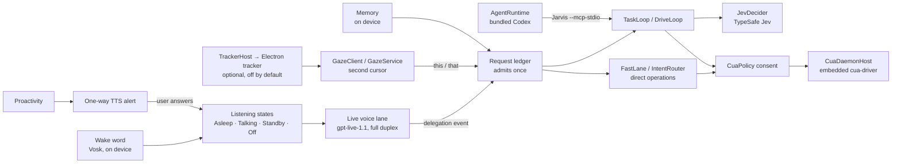

# Architecture

One Swift app (`Sources/Jarvis`), a small core library
(`Sources/JarvisCore`), and a bundled Electron eye tracker
(`EyeTracking/`). Everything ships inside one signed app bundle.

Jarvis is a hands-free personal agent (DECISIONS.md, 2026-11-20). This
map shows that design. **Today** notes say where the code still differs
and which roadmap step (L1–L11) closes the gap.

## Voice (`Voice/`)

Listening has four states. **Asleep**: the on-device wake word
(`VoskWakeWordDetector`) listens for "Hey <name>"; nothing leaves the Mac
and it costs nothing. **Talking**: a gpt-live-1.1 session hears and
answers in full duplex, so the user can talk over Jarvis. **Standby**:
after a short silence (about 8 s) the session pauses; speaking again
resumes it without the name. About 90 s after the last turn Jarvis goes
back to Asleep. "That's all" sleeps at once; "stay with me" keeps the
session open. **Off**: Pause Listening in the menu bar. A glow shows the
state; the menu-bar item stays.

The Live session never acts and has no tools. When it needs something
done it sends a client delegation (`session.delegation.created`, which
carries no task text); Jarvis builds the request from the conversation
transcript, and the request ledger admits it exactly once, even when the
session delegates twice, the user talks over it, or someone else speaks
nearby. Admitted requests go to `IntentRouter` and `FastLane` for direct
operations or to the task loop; `VoiceSemanticRouter` asks Jev when a
request needs a semantic decision. "Type this '…'" inserts the words
verbatim; "come up with a reply for this" drafts and confirms before
sending.

**Today:** `VoiceController` owns the capsule and the modes in
`ListeningMode` (Hands-free, wait for "Hey <name>", Hold fn).
`RealtimeVoiceLane` streams to OpenAI Realtime (gpt-realtime-2.1), and
the committed input transcript is the final text; `VoiceActivityGate`
(Silero VAD) sends only speech; `LocalSpeechSession` admits each turn
once. The Live lane arrives behind `voice.live` (L1–L3), the Fn code goes
in L4, and the Realtime lane in L11.

## Acting on the Mac (`Drive/`, `Driver/`, `Consent/`, `ComputerControl/`)

`FastLane` handles direct grounded operations with no model call.
Everything else runs through `TaskLoop` (via `DriveLoop`): observe through
accessibility, ask `JevDecider` to choose, act, settle, repeat. Every action
passes `CuaPolicy`, one consent choke point with a standing grant and a deny
list the grant never bypasses. An explicit request runs at once with a
highlight; only consequential actions the user didn't ask for are
confirmed. `CuaDaemonHost` runs the embedded, pinned `cua-driver`, which
every consumer shares.

## Eyes (`Gaze/`, `EyeTracking/`)

Eye tracking is optional and off by default. `TrackerHost` launches the
tracker bundled at `Contents/Resources/EyeTracker` and restarts it within
a budget. `GazeClient` and `GazeStream` read gaze over a local socket.
Gaze is a second cursor: it resolves "this" or "that" in a spoken command
to the element the user is looking at, and deciders receive that
element's identity, never raw coordinates. Gaze never wakes Jarvis and
never selects; selection is voice, click or key. **Today:** the
"this/that" resolution is built in L6.

## Memory (planned, L8)

People, preferences and past requests are stored on the Mac only. The
user can view and delete every item.

## Proactivity (planned, L9)

Speak-now events (a meeting now or a clash, an urgent message from an
important person, an awaited reply, a requested reminder, scam or
security warnings) are spoken in one sentence with an offer through a
one-way TTS; a Live session opens only if the user answers. Other events
show on the glow or wait for "what did I miss". Nothing is spoken while
the user is talking, on a call, screen-sharing, presenting or in a Focus
that blocks it.

## Agents (`Agents/`)

Persistent agents run on the bundled `CodexRuntime/codex`. They reach the
same task loop through `Jarvis --mcp-stdio --agent <slug>`, an MCP server
mode of the app binary.

## Credential service (`CredentialService/`)

A Cloudflare Worker holds the owner's OpenAI and TypeSafe keys. Installs
register for a token, mint short-lived Realtime client secrets and send
Terra and Jev calls through it, under per-install and global limits kept
in one Durable Object. See its README. **Today:** the app still reads keys
from Settings. L1 adds a route that exchanges the Live WebRTC offer so no
key reaches the Mac, and L10 replaces the daily spend estimate with
per-minute metering and the $30 and $100 plan limits.

## Diagnostics (`Support/`)

`DiagnosticsReporter` subscribes to MetricKit and keeps the last 20 crash
and hang payloads. **Export Logs…** writes this process's OSLog entries plus
the `LatencyLedger` report to a file the user picks.
