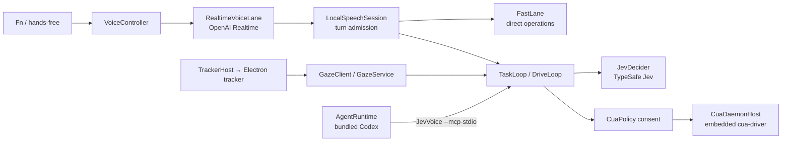

# Architecture

One Swift app (`Sources/JevVoice`), a small core library
(`Sources/JevVoiceCore`), and a bundled Electron eye tracker
(`EyeTracking/`). Everything ships inside one signed app bundle.

## Voice (`Voice/`)

`VoiceController` owns the capsule state and the Fn / hands-free input.
`RealtimeVoiceLane` streams microphone audio to OpenAI Realtime; the
committed input transcript is the final text. `LocalSpeechSession` admits
each turn exactly once and decides whether it is dictation, a direct
operation, or work for the task loop. `VoiceSemanticRouter` asks Jev when a
turn needs a semantic decision.

## Acting on the Mac (`Drive/`, `Driver/`, `Consent/`, `ComputerControl/`)

`FastLane` handles direct grounded operations with no model call.
Everything else runs through `TaskLoop` (via `DriveLoop`): observe through
accessibility, ask `JevDecider` to choose, act, settle, repeat. Every action
passes `CuaPolicy`, one consent choke point with a standing grant and a deny
list the grant never bypasses. `CuaDaemonHost` runs the embedded, pinned
`cua-driver`, which every consumer shares.

## Eyes (`Gaze/`, `EyeTracking/`)

`TrackerHost` launches the tracker bundled at
`Contents/Resources/EyeTracker` and restarts it within a budget.
`GazeClient` and `GazeStream` read gaze over a local socket. Gaze only
targets; selection is always a separate channel (voice, click or key).

## Agents (`Agents/`)

Persistent agents run on the bundled `CodexRuntime/codex`. They reach the
same task loop through `JevVoice --mcp-stdio --agent <slug>`, an MCP server
mode of the app binary.

## Diagnostics (`Support/`)

`DiagnosticsReporter` subscribes to MetricKit and keeps the last 20 crash
and hang payloads. **Export Logs…** writes this process's OSLog entries plus
the `LatencyLedger` report to a file the user picks.
