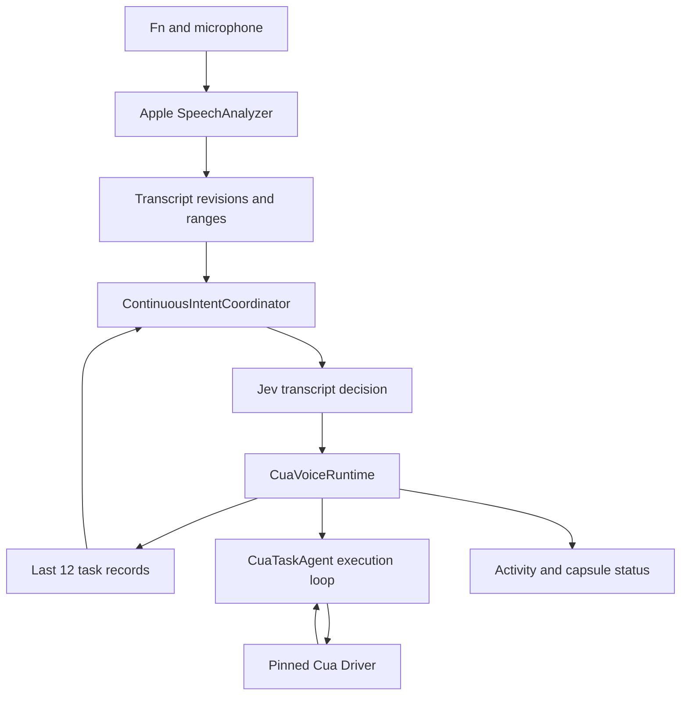
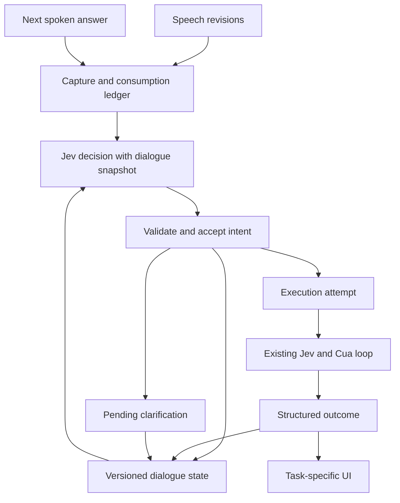

# Report: coordination, memory and voice failures

**The main problem is the contract between understanding a request and executing it.** Jarvis preserves speech provenance and constrains desktop actions, but its coordination state cannot adequately represent conversational relationships, retries, clarification, and changing targets.

Your hypothesis is substantially supported: **a correct Jev decision can become an incorrect runtime instruction.** Replacing Cua or speech recognition would not fix that.

This investigation was read-only. No changes, baseline runs, or repeated failure demonstrations. Findings below combine the existing Activity evidence, source inspection, research papers, official documentation and GitHub implementations.

## 1. Current architecture

The individual responsibilities are reasonable:

- Apple transcribes audio.
- The coordinator manages changing transcript hypotheses and consumed spans.
- Jev selects meaning and grounded actions.
- Cua observes and acts.
- Jarvis manages task ownership, cancellation and user interaction.

**The weak point is that the retained task records are being used as conversation memory, execution dependencies and window ownership at the same time.** Those are different things.

## 2. What is wrong

### A. A conversational reference becomes a mandatory execution dependency

**Confirmed defect; directly explains five of your failures.**

`CuaTaskAgent.swift:229` asks which previous task a follow-up refers to. At line 377, the selected task becomes `dependencyTaskID`.

`CuaVoiceRuntime.swift:357–377` then:

1. Finds that task.
2. Waits for it if necessary.
3. Requires its status to be `Completed`.
4. Inherits its window.

That combines several different meanings:

| What the user means | What the runtime needs |
|---|---|
| “In that same app…” | App context |
| “In that window…” | A target reference |
| “Try that again.” | A new attempt, after inspecting prior effects |
| “Actually, do this instead.” | A revision or replacement |
| “Use the result from that task.” | A genuine prerequisite |

Currently, these can all collapse into “previous task must have succeeded.”

Your Calculator sequence demonstrates the consequence: after one failure, later requests keep referring to that activity and are rejected before Cua gets another opportunity.

**Necessary fix:** represent the relationship separately from the referenced task. A task reference must not automatically create a dependency or transfer a window.

Do not fix this by allowing every failed dependency to continue. Some requests genuinely require a prior result, and some failed attempts may already have caused effects.

---

### B. Task history is not sufficient conversation memory

**Confirmed architectural limitation.**

`CuaVoiceRuntime.swift:88–92` exports the last twelve tasks with their request, app, status and result text.

Missing explicit concepts include:

- The user’s current goal.
- The task currently in conversational focus.
- An unresolved question awaiting an answer.
- Whether a new utterance retries, revises or replaces an earlier request.
- Which observed result remains usable after a partial failure.
- Which target was last verified, and when.
- Whether the user has explicitly changed destination.

The UI’s selected task is not included in that context and is reset on each capture begin. An older active task can also fall outside the twelve-task window.

This is not primarily a “needs more tokens” problem. Enlarging the history would retain more records without making their relationships clearer.

**Necessary fix:** maintain a small, explicit dialogue state. Keep task history as evidence, not as the sole representation of the conversation.

A vector database, long-term memory service or full transcript replay is unnecessary for these failures.

---

### C. Clarification is displayed, but not represented as resumable work

**Confirmed architectural limitation.**

There are two related cases:

- An initial clarification updates the coordinator’s message, but creates no persistent pending-question object.
- A window-selection clarification during execution throws an error and becomes a failed task.

The next Fn hold resets the capture ledger and coordinator message. There is no explicit relationship connecting a subsequent answer—such as “the front window”—to the question and original request.

The old request may remain somewhere in task history, but that is not a reliable continuation mechanism.

**Necessary fix:** introduce an `awaitingClarification` state containing:

- The original intent.
- The unresolved field.
- The question.
- Candidate references, where applicable.
- The relevant intent revision.
- The rule for applying an answer.

An answer should resolve the missing information and resume the intent from fresh observation. It should not require the user to repeat the entire command.

---

### D. A remembered window ID is treated as current execution authority

**Confirmed unsafe coupling; the exact cause of your first Calculator failure remains unresolved.**

`CuaVoiceRuntime.swift:377` passes the related task’s window ID into the new execution. It does not first establish that the referenced task’s app matches the newly selected app.

The executor then checks whether that ID appears in the target app’s current window list. If it does not, it reports that the pinned window closed.

That refusal prevents acting on the wrong window, which is good. But the message does not distinguish:

- A genuinely closed window.
- A stale reference.
- A reference inherited from the wrong app.
- A temporarily incomplete observation.

**Necessary fix:** separate a remembered target preference from a currently verified target.

A remembered target should carry app identity and enough provenance to resolve it. Before use, the executor must bind it to a fresh observation. If continuity cannot be established, ask for clarification rather than silently substituting another window.

**The safety check should stay. The incorrect inheritance should go.**

---

### E. Jev’s independent answers are being combined as if they were a coordinated plan

**Source-confirmed design risk, newly reinforced by official TypeSafe documentation.**

TypeSafe explicitly states that questions in one request are evaluated **independently and in isolation against the same state**. They do not see one another’s answers. [1]

Our first decision asks about operation, task, app, scope, visibility, content mode and source spans together. Several question instructions refer to what another question “selected.”

That is not automatically invalid: independent answers can be useful when each is a self-contained judgment. But the application must compose them correctly.

For example:

- “This refers to task A” can be correct.
- “The target app is Calculator” can be correct.
- “Execute” can be correct.
- Combining them into “reuse task A’s window and require A to have completed” can still be wrong.

There are existing compatibility checks, such as rejecting contradictory launch/literal selections. The relationship and target contracts need equivalent rigor.

**Necessary fix:**

- Ask atomic questions grounded in explicit state.
- Distinguish relationship from execution prerequisites.
- Validate the complete decision before accepting it.
- Where a judgment genuinely requires an earlier answer, resolve it in a subsequent bounded step within the same execution workflow.

This does **not** require adding another model or restoring a separate speech interpreter.

---

### F. Transcript freshness is tracked more carefully than context freshness

**Confirmed timing risk; not proven to have caused your recorded failures.**

`ContinuousIntentCoordinator.swift:200–202` snapshots task context when scheduling a handoff. That snapshot can then wait through debounce, Driver setup and a model request.

Meanwhile, tasks may complete, fail, change targets or receive cancellation.

There is also a concrete publication-order issue:

1. `createWork` appends a queued task.
2. `speech.consume` immediately schedules the remaining speech.
3. The next handoff captures context.
4. The previous task’s worker begins and fills in further execution state.

The next decision can therefore receive a just-created task with an empty app field and little useful context.

Being on `@MainActor` does not make an asynchronous sequence atomic. Swift’s actor model explicitly permits state changes across suspension points. [7]

**Necessary fix:**

- Publish known intent metadata before scheduling subsequent speech.
- Version dialogue state.
- Record which context facts a decision relied on.
- Revalidate those facts when accepting the decision.
- Refresh only decisions affected by meaningful changes, not every progress update.

This should be a bounded state-management improvement, not a new orchestration framework.

---

### G. Capture status, task status and dialogue status bleed into one another

**Confirmed source-level problem.**

`VoiceController.swift:440–455` uses global runtime activity and the last task’s failure when deciding the current interaction’s status.

That can make the current hold appear to be working because another task is active, or surface a previous failure even when the current input did not create a new task.

The UI selection is also used by cancellation machinery, while conversational focus has no separate representation.

**Necessary fix:** maintain three distinct states:

1. **Capture:** preparing, listening, finalizing, unavailable.
2. **Dialogue:** interpreting, awaiting clarification, accepted, no actionable request.
3. **Execution:** queued, running, awaiting approval, completed, failed, uncertain, cancelled.

The capsule can display a combined view, but one state must not be inferred from an unrelated task’s position in an array.

---

### H. Failure and correction handling discard useful distinctions

**Confirmed architectural limitation.**

`runSelected` generally reduces errors to `Failed` plus a string. Yet these outcomes require very different handling:

- Nothing was dispatched.
- A target was ambiguous.
- A prerequisite was missing.
- An action was rejected before execution.
- Some effects occurred.
- The outcome is unknown.
- The user cancelled.

Likewise, correction handling distinguishes a reversible launch from a coarse `dispatchedEffect` flag. It does not provide a general representation of “the original goal remains, but this attempt cannot safely continue.”

**Necessary fix:** separate the user’s intent from individual execution attempts and preserve structured outcomes.

A failed attempt should not poison the goal or unrelated future work. An uncertain effect should block automatic replay of that effect—not every future request concerning the app.

## 3. What the research says

The relevant literature supports explicit state and lifecycle boundaries, rather than simply giving an agent more history.

| Source | Relevant finding | Application here |
|---|---|---|
| **Schlangen & Skantze, 2011 — incremental dialogue processing** [2] | Incremental hypotheses need identity, grounding, revision and commitment. Irreversible action changes how later corrections must be handled. | Preserve transcript provenance; distinguish provisional interpretation from accepted intent and dispatched effects. |
| **Jacqmin et al., 2022 — dialogue state tracking survey** [3] | Conversation state must accumulate and revise user needs. Earlier mistakes can propagate, and individually strong components do not guarantee a successful system. | Replace task-list-only memory with explicit, revisable dialogue state. |
| **Microsoft/Semantic Machines — Task-Oriented Dialogue as Dataflow Synthesis** [4] | Reference, revision, preflight and commit are distinct operations. Clarification is part of continued interaction. | Represent “same target,” “retry,” “change this,” and “requires that result” separately. Borrow the semantics, not a whole programming language. |
| **TypeSafe official documentation** [1] | Questions are independent; applications compose atomic judgments in code. | Repair the decision schema and composition logic before blaming Jev’s understanding. |
| **Apple SpeechAnalyzer documentation/session** [5] | Finality applies to a range of audio; volatile results replace earlier hypotheses for that range. | A finalized speech segment is not, by itself, proof that the user has finished expressing an instruction. |
| **LiveKit turn-handling documentation** [6] | Turn completion, interruption and speculative generation are separate mechanisms. Speculative work must be cancelled when input changes. | Keep early computation separate from permission to mutate the desktop. Do not import LiveKit just for this principle. |
| **Swift actor proposal** [7] | Actors prevent data races, but logical invariants can change across `await`. | Use versioned snapshots and short synchronous state transitions. |
| **LangGraph interrupt documentation** [8] | Clarification/approval requires saved state and an explicit resume identity; replay can repeat side effects. | Implement a small native continuation contract, not a LangGraph migration. |

The research does not prove which window disappeared during your test. It does establish that the current coordination design lacks distinctions these systems need.

## 4. The necessary design change

**Evolve the existing runtime into a small, typed dialogue-and-task coordinator. Keep one Jev/Cua execution workflow.**

### A. Give the runtime the right records

These are conceptual records, not a requirement for five new services or files.

| Record | Owns |
|---|---|
| **Capture** | Audio/transcript revision, finality, consumed source ranges |
| **Intent** | The user’s goal, constraints, literal payload, revision and relationship |
| **Execution attempt** | One run of an intent, cancellation, dispatched effects and outcome |
| **Target reference** | Remembered destination plus current binding/provenance |
| **Pending clarification** | Question, missing information and continuation identity |

The key distinction is:

> **One user intent can survive several captures, clarifications and execution attempts.**

Today, those lifecycles are too tightly coupled.

### B. Make relationships explicit

The decision contract needs to distinguish:

- New independent request.
- Continuation in the same context.
- Retry of an earlier intent.
- Revision or replacement.
- Cancellation.
- Answer to a pending question.
- Genuine dependency on a previous result.

Only the last category should impose a prerequisite, and that prerequisite should name the required fact or artifact—not merely a blanket `Completed` status.

For example, an earlier task could have opened a document successfully but failed while typing. A later request may legitimately use that document, provided it is freshly verified.

### C. Keep useful working memory, not indiscriminate history

The decision snapshot should contain:

- All relevant active intents.
- The pending clarification, if any.
- Conversational focus, separate from UI selection.
- Relevant recent completed or failed attempts.
- Verified target and result references.
- Explicit uncertainty about prior effects.
- The current capture and source span.

Keep this in memory by default, consistent with the existing privacy specification. Raw transcripts and screenshots should not become persistent history merely to solve coordination.

### D. Accept decisions atomically

Before starting an attempt:

1. Confirm the source span remains valid.
2. Confirm referenced intents/questions still exist and are applicable.
3. Check relationship, app and target compatibility.
4. Validate required prerequisites.
5. Publish the intent and known target metadata.
6. Claim the source span once.
7. Schedule execution and any remaining speech.

Network and Driver work stays outside that short state transition.

Do not automatically “unconsume” failed speech. That would recreate replay problems. An explicit retry creates a new attempt tied to the existing intent.

### E. Treat clarification as a normal state

“Which window?” should produce:

- A pending goal.
- A missing target.
- A concise question.
- A resumable continuation.

When the user answers, resolve the answer against that continuation and refresh the desktop observation. Do not preserve old screenshot coordinates as authority while waiting.

If several questions are pending, ask which task the answer concerns rather than guessing.

### F. Preserve early voice execution without confusing finality with authorization

Apple’s final transcript segments are useful stability signals. They are not semantic end-of-turn signals.

Continue using one Jev workflow to decide whether a complete actionable request exists. Preserve:

- Revision cancellation.
- Exact literal-source spans.
- No replay on Fn release.
- Explicit manual-mode approval.
- Safe handling of late results.

Use early speech for observation and decision preparation. Early mutation requires an accepted complete request whose relevant scope is resolved. High-impact actions still obey their existing authorization rules.

**Do not “fix” this by making every command wait for release**, because that silently removes the continuous-control behavior the specification requires.

### G. Return structured outcomes

The coordinator needs outcomes such as:

- Completed with observed evidence.
- Awaiting clarification.
- Blocked by a specific prerequisite.
- Failed before dispatch.
- Partially completed.
- Effect uncertain.
- Cancelled.

These determine what can happen next.

A retry policy must inspect the previous attempt’s effects. “Retry” cannot mean replaying the old action sequence from the beginning.

### H. Make diagnostics explain coordination

The missing diagnostic is not another generic error log. It is the causal record:

- Which intent was selected?
- What relationship was chosen?
- Which prerequisite was required?
- Why was a target inherited?
- Which context revision was used?
- Did execution actually begin?
- Which effects were confirmed or uncertain?

Show this in Activity without exposing credentials or retaining raw audio. That would have made the failed-dependency chain immediately understandable.

## 5. What should stay—and what should not be added

### Keep

- Apple SpeechAnalyzer and the existing audio-range/revision machinery.
- Jev as the semantic and grounded-action decision backend.
- Cua Driver and Perception.
- Exact-target checks and refusal to replay uncertain mutations.
- Current Keychain, permission and UI infrastructure.
- App-level leases until narrower ownership is actually supported.

### Do not add as the primary fix

- A second autonomous planner.
- Another complete voice stack.
- A vector database.
- A blanket retry loop.
- A larger unfiltered history window.
- A Cua upgrade presented as a cure for conversation state.
- LangGraph, LiveKit or arc-cua as a wholesale runtime replacement.

**arc-cua remains useful as an execution reference**, especially for bounded subtasks and UI settling. It deliberately leaves the planner outside its package, so it does not supply the missing conversational coordination.

There are also real, separately documented Driver limitations—such as pinned-runtime repeated-scroll verification and launch-watchdog behavior. Those should remain a separate workstream. They do not explain why a new Calculator request was rejected as dependent on a failed task.

## 6. Risks and how to contain them

| Risk | Required constraint |
|---|---|
| Retry repeats a partial action | Inspect prior effects and current state before any new mutation |
| New context selects a different document | Rebind with identity evidence; clarify if ambiguous |
| Context updates endlessly cancel decisions | Invalidate only decisions depending on changed facts |
| Clarification resumes an obsolete request | Bind answers to intent/question revisions |
| More memory increases privacy exposure | Keep bounded in-memory state; redact diagnostic exports |
| Refactor creates two coordinators | Move ownership into the existing runtime; remove duplicated decisions |
| Concurrent tasks compete for focus | Preserve existing leases and explicit foreground authorization |

## 7. Recommendation

**Fix the coordination contract before changing the executor or speech provider.**

The work should proceed in this order:

1. **Separate task references, retries and true dependencies.**
2. **Separate intent identity from execution-attempt identity.**
3. **Add resumable clarification and explicit conversational focus.**
4. **Replace raw window inheritance with validated target continuity.**
5. **Version context and make intent acceptance atomic.**
6. **Separate capture/dialogue/execution UI state and expose structured outcomes.**

That addresses the demonstrated failure cascade and the closely related architectural gaps without discarding the parts already doing useful work.

We do not need another baseline exercise to establish that your experience is broken. Future verification should establish that the new contracts prevent those failures—not repeatedly demonstrate the old behavior.

**The central fix is not “make Jev smarter.” It is “stop forcing different conversational meanings into the same task/dependency/window fields.”**

Switch to plan mode to formalize this design.

## Sources

1. TypeSafe: [Introduction and independent question evaluation](https://docs.typesafe.ai/introduction), [State design](https://docs.typesafe.ai/concepts/state).
2. Schlangen & Skantze: [A General, Abstract Model of Incremental Dialogue Processing](https://aclanthology.org/2011.dnd-2.11/), particularly revision and commitment.
3. Jacqmin, Rojas-Barahona & Favre: [“Do you follow me?”—Dialogue State Tracking survey](https://aclanthology.org/2022.sigdial-1.33/), particularly error propagation and system-level relevance.
4. Microsoft/Semantic Machines: [Task-Oriented Dialogue as Dataflow Synthesis](https://github.com/microsoft/task_oriented_dialogue_as_dataflow_synthesis), [reference, revision and preflight/commit semantics](https://github.com/microsoft/task_oriented_dialogue_as_dataflow_synthesis/blob/master/README-SEMANTICS.md).
5. Apple: [Bring advanced speech-to-text to your app with SpeechAnalyzer](https://developer.apple.com/videos/play/wwdc2025/277/).
6. LiveKit: [Turn-taking tuning](https://docs.livekit.io/agents/logic/turns/tuning/).
7. Swift: [SE-0306 actor reentrancy](https://github.com/swiftlang/swift-evolution/blob/main/proposals/0306-actors.md#actor-reentrancy).
8. LangGraph: [Interrupts, state and safe resumption](https://docs.langchain.com/oss/python/langgraph/interrupts).
9. arc-cua: [Architecture](https://github.com/shhivv/arc-cua), [runtime implementation](https://github.com/shhivv/arc-cua/blob/master/src/arc_cua/runtime.py).

## Critical Files

- `Sources/JevVoice/ComputerControl/CuaVoiceRuntime.swift` — dialogue ownership, task relationships, attempts, clarification and outcomes.
- `Sources/JevVoice/ComputerControl/CuaTaskAgent.swift` — decision contract and validated execution handoff.
- `Sources/JevVoice/Voice/ContinuousIntentCoordinator.swift` — transcript acceptance and context freshness.
- `Sources/JevVoice/Voice/VoiceController.swift` — capture lifecycle and correctly scoped UI/cancellation.
- `Sources/JevVoiceCore/Speech/SpeechConsumption.swift` — preserve source-span ownership and replay protection.
